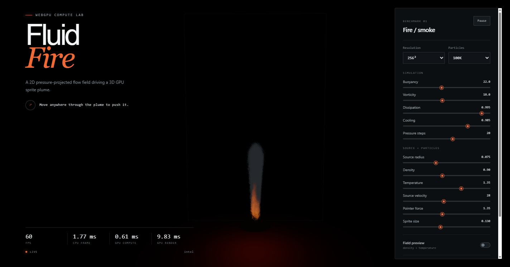
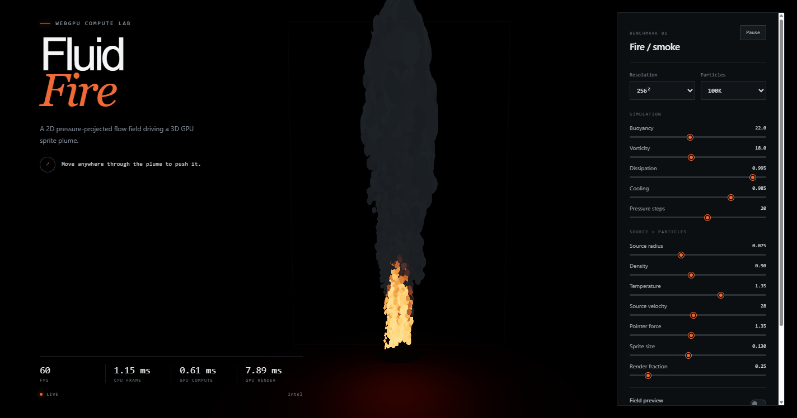
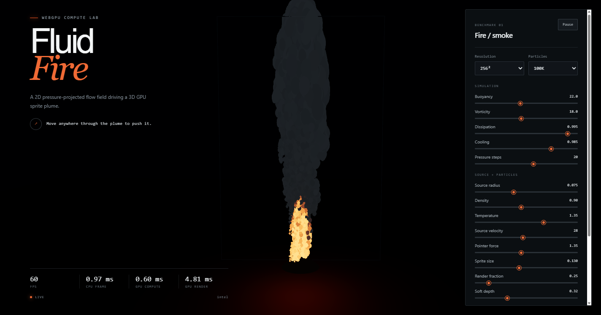
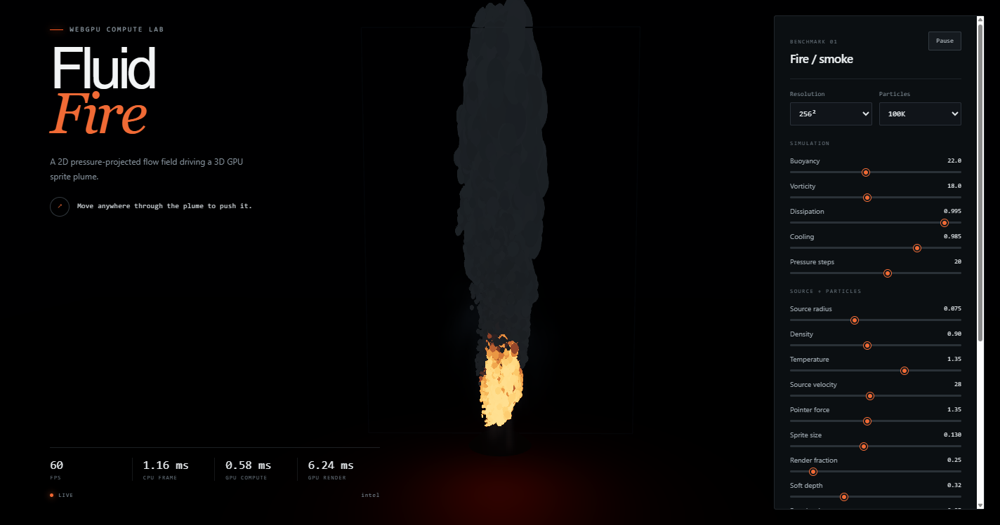

# ninja3js

Stylised ground mist, GPU fluid and ground-response effects for Three.js WebGPU. Clean-room,
FluidNinja-inspired. **Current status (Oct 2026):** shipped as a package for its first host, the
[arena](https://github.com/Fl0tto/arena-showdown) 3D battle client (its M4). Read
[the resume checkpoint](./docs/RESUME.md) before continuing; [HANDOFF.md](./docs/HANDOFF.md)
contains the demo's implementation history.

## Using it as a package

```sh
pnpm add github:Fl0tto/ninja3js#v0.2.0     # or link a sibling checkout: "ninja3js": "link:../ninja3js"
```

`three` is a peer dependency (`>=0.185 <0.190`); the package ships TypeScript source through its
`exports`, so any Vite/esbuild host consumes it without a build step. With a `link:` checkout, dedupe
`three` in the host's Vite config and map `three*` to the host's `@types/three` in its tsconfig
`paths`, or the two checkouts bring two copies.

```ts
import { GroundMist } from 'ninja3js';

const mist = new GroundMist(renderer, { width: 16, depth: 16, height: 0.9, resolution: 128 });
scene.add(mist.group);
mist.setAmbient(0.4);                                   // baseline blanket
mist.setPalette('#dfe7f1', '#ff9a4a');                  // cool mist, hot smoke
mist.setWind(new THREE.Vector3(2, 0, 0.5));
mist.emit(position, 0.8, 1, { heat: 1.2, duration: 1.5 }); // a smoke source for 1.5 s
mist.blast(position, 2.5, 5);                           // shove the mist outward
mist.mover('player', position, velocity, 0.5);          // a wake, every frame while moving
mist.update(dt);                                        // before renderer.render()
```

`GroundMist` is the host-facing class: one bounded X/Z window (fixed, or scrolling with
`follow()`), world units everywhere, slot allocation and lifetimes inside. It needs the WebGPU
backend (`GroundMist.isSupported(renderer)`); on a WebGL2 fallback the host simply does not create
one. `mist.html` is the smallest host example and `npm run smoke:mist` renders it headless on
SwiftShader's Vulkan ICD (real WebGPU, no GPU) and screenshots it.

The lower layers are exported too: `FluidFire` (the solver, with `visuals: false` for hosts that
render the fields themselves, configurable `bounds`, an ambient density floor and per-stamp heat),
`GroundFlowVolume` and `GroundResponseField` (the demo's fog/sand/snow/grass renderer),
`SimulationWindow`, `TerrainHeight`. Gameplay (the training chamber, sentinel, controls, benchmark
UI, demo terrain) stays in the demo.

## The demo

A standalone Three.js/WebGPU prototype of a 2.5D fire-and-smoke pipeline:

```text
RGBA16F 2D fluid fields -> GPU particle buffers -> 3D transparent sprites
```

The active implementation direction is a player-centred, landscape-aligned flow volume for localized fog, sand and snow. Its client-local MMO model, scrolling simulation window and interaction contract are documented in [Ground-flow volume](./docs/GROUND_FLOW_VOLUME.md). The current fire plume is retained as the compute/render benchmark from which that system evolves.

The implementation is clean-room. The supplied FluidNinja LIVE 2 project was used to identify architecture and visual techniques; no Unreal or FluidNinja source was copied into the shaders. See [the reference analysis](./docs/FLUIDNINJA_REFERENCE.md).

### Run

Requirements: a current Chrome or Edge build with WebGPU support, plus Node.js 20 or newer.

```powershell
npm install
npm run dev
```

Open the URL printed by Vite. The default Training Chamber combines mist, grass, Sand/Snow patches and reactive trees inside a stone room. Move through its south doorway with WASD; room walls block movement and contain effects. Click the armored sentinel to aim a sword slash: Modest/Powerful deal 18/42 damage once per stroke, with stagger and a health display. The sentinel marks your position with an amber circle before striking. Move clear or press Shift for a timed dodge (WASD sets direction; standing still dodges backward). The player has 100 health; each sentinel strike deals 25 damage. At zero health, movement, slashes and dodges stop. Retry encounter restores both characters, clears active attacks and returns you to the starting position. The HUD tracks health, hits taken and timed dodges. The sentinel resets three seconds after defeat, or immediately with Reset target. Use the top-left controls to choose Overworld/Dungeon camera and Modest/Powerful slash. Click to aim or press Space to cast ahead; scroll to zoom. Selecting an isolated material in the right panel switches to the diagnostic view. Click to cast a curved sword slash, drag over the ground fog to inject flow, and use W/A/S/D to move the player and its client-local simulation window. The right panel changes solver/source parameters live; resolution and particle-count changes rebuild GPU resources.

Other commands:

```powershell
npm run build
npm run preview
```

The Vite config uses its module-runner config loader because this workspace is inside OneDrive, where reparse-point metadata can confuse esbuild's optional config/dependency pre-bundle traversal.

## Current architecture

The Clearing now uses terrain-following ground mist rendered with a 24-step camera-ray march clipped against opaque scene depth. This replaces the horizontal ground-fog sheets and supports close dungeon views. Its muted woodland palette is an initial art-direction pass; the historical fire benchmark descriptions below remain separate.

The material selector now chooses independent solvers. Fog uses the fluid pipeline below. Sand, Snow and Grass each own two additional RGBA16F response textures: height offset, compaction, and bend. Only the selected solver advances; all ground response fields scroll with the player window. Sand has repose-threshold settling, Snow retains imprints, and Grass bends and recovers. Solid surfaces no longer sample fog density/velocity. Shared terrain sampling now drives ground height, Sand slopes, fog sheets, grass roots, actor placement and pointer hits. A continuous 140 m ground mesh extends beyond the 14 m response window; disturbances blend to passive terrain near its edge. Full granular transport and reference-matched detail remain on the roadmap.

At the default 256² resolution, seven ping-pong/temporary `RGBA16F` storage textures represent:

- two velocity fields (`RG`, cells/second)
- two scalar fields (`R` density, `G` temperature)
- two pressure fields (`R`)
- one temporary field (`R`, curl first and divergence afterward)

Each Fog frame executes:

1. update eight animated GPU source brushes
2. semi-Lagrangian velocity advection, dissipation, buoyancy, source and pointer injection
3. curl calculation
4. vorticity confinement
5. divergence calculation
6. configurable Jacobi pressure iterations
7. pressure-gradient subtraction
8. semi-Lagrangian density/temperature advection, dissipation/cooling and source injection
9. one GPU visualization-particle update

The particle state is three `vec4` storage buffers: position/age, velocity/lifetime, and size/seed/temperature/density. A Three.js `SpriteNodeMaterial` renders the same buffers directly, so there is no per-frame CPU readback or upload.

The full selected particle count remains simulated. A heat-aware, stable stochastic render fraction collapses redundant smoke sprites in the vertex stage while preserving hot flame particles; opacity compensation retains the plume body. A deterministic 16-variant cloud atlas is generated once at startup, giving the sprites irregular silhouettes and internal breakup for one texture lookup. The render-fraction control makes the overdraw/quality tradeoff directly benchmarkable. Scene-depth sampling softly fades billboards at opaque geometry instead of leaving hard intersections.

The public prototype surface is already close to the intended game API:

```ts
const fire = new FluidFire(scene, renderer, {
  resolution: 256,
  particleCount: 100_000,
});

fire.setPosition(x, y, z);
fire.addEmitter({
  position: new THREE.Vector3(0, 0.2, 0),
  radius: 0.2,
  density: 1,
  temperature: 1,
  velocity: new THREE.Vector3(0, 2, 0),
});
fire.update(dt);
```

This milestone intentionally supports one emitter. Multi-emitter arrays, moving obstacles and sparks are subsequent work, not a generic Niagara runtime. An optional eight-slice dynamic-fog preview now samples the transported density/temperature field directly; its final quality strategy and measurable acceptance criteria are tracked in [the implementation roadmap](./docs/ROADMAP.md).

## First benchmark result

The checked-in smoke test ran the default setup in headless Chrome on the local Intel WebGPU adapter at a 1424 × 749 render surface:

| Configuration | Result |
|---|---:|
| Fluid | 256², 20 Jacobi iterations |
| Particles | 100,000 GPU sprites |
| Compute passes | 27/frame |
| GPU compute timestamp | 0.61 ms |
| GPU render timestamp | 9.83 ms |
| Observed frame rate | 60 FPS |



These are a single-machine smoke-test result, not a general performance claim. Repeated production/development runs ranged from 0.61–0.96 ms compute and 7.4–9.8 ms render. The useful early signal is the ratio: transparent rendering cost was about an order of magnitude above compute, so overdraw is the first optimization target on this adapter. Timestamp queries are shown as `n/a` in the UI on adapters that do not expose the feature.

## Rendering/source pass

The next pass kept all 100,000 particles in the GPU simulation while rendering a stable 25% smoke subset, retaining hot flame particles as they transition through the emissive range. It also added the generated cloud atlas and eight animated GPU source brushes. On the same headless test setup this measured:

| Configuration | Result |
|---|---:|
| Fluid | 256², 20 Jacobi iterations |
| Simulated particles | 100,000 |
| Default smoke render fraction | 25% |
| Compute passes | 28/frame |
| GPU compute timestamp | 0.61 ms |
| GPU render timestamp | 7.89 ms |
| Observed frame rate | 60 FPS |



That is about a 20% render-time reduction from the original 9.83 ms capture on this adapter. The live render-fraction slider can restore all smoke particles or trade more of them for fill-rate headroom without rebuilding the simulation.

## Depth and dynamic-fog pass

Smoke and flame billboards now sample linear scene depth and fade over a configurable world-space distance near opaque geometry. The optional dynamic-fog preview renders eight depth-aware slices through the same transported density/temperature field, using exponential per-slice absorption and no CPU readback. Its absorption (extinction) and scattering tints are independent live controls, so volume thickness can be tuned without changing the smoke-light color.

A paired headless capture at 256² and 100,000 simulated particles measured:

| Dynamic fog | GPU compute | GPU render | FPS |
|---|---:|---:|---:|
| Disabled | 0.64 ms | 4.36 ms | 60 |
| Eight slices | 0.58 ms | 6.24 ms | 60 |
| Fog delta | — | +1.88 ms | — |





The fog control now compares the original eight-slice baseline with a six-step, single-proxy-plane ray march. In the local headless 256²/100,000-particle smoke test at a 764 × 429 surface, the slice path measured 6.84 ms GPU render time and the ray march 5.72 ms (about 16% lower). The ray march is therefore the default, while the slice path stays available for direct A/B comparison. This is an initial single-machine cost/behavior probe, not a production-wide performance claim.

## Verification

`npm run build` performs strict TypeScript checking and a production bundle. `tools/cdp-smoke.mjs` is the browser-side check used to reload the page through Chrome DevTools Protocol, wait for shader compilation, collect exceptions/console diagnostics, query the live metrics and optionally capture a screenshot.

